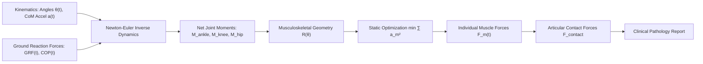

# BiomechGait: Musculoskeletal Inverse Dynamics & Hill-Type Muscle Force Distribution for Clinical Gait Rehabilitation

[](https://github.com/ZengLLQ/biomech-gait/actions/workflows/ci.yml)
[](https://python.org)
[](LICENSE)

A clinical and computational biomechanics library for **multi-body lower-limb inverse dynamics**, **Hill-type muscle-tendon force distribution via static optimization**, and **clinical gait pathology analysis** (Cerebral Palsy crouch gait, Post-stroke stiff-knee gait, and Tibiofemoral knee osteoarthritis contact force progression).

---

## 1. Clinical & Rehabilitation Motivation

Pathological gait disorders arise from neurological impairments (e.g. spasticity, contracture, weakness in cerebral palsy or stroke) and musculoskeletal degenerative diseases (e.g. knee osteoarthritis). Clinical decision making—such as prescribing tendon lengthening, muscle transposition surgery, botulinum toxin injections, or orthoses (AFO, GRAFO)—relies heavily on quantifying non-observable internal kinetics and muscle forces:

1. **Tibiofemoral Contact Forces:** Excessive compressive joint loading ($> 4.5 \times \text{body weight}$) accelerates articular cartilage wear in osteoarthritis.
2. **Crouch Gait (Cerebral Palsy):** Excessive knee and hip flexion throughout stance phase leads to severe quadriceps fatigue, patella alta, and crouch progression.
3. **Stiff-Knee Gait (Stroke Hemiparesis):** Insufficient swing-phase knee flexion ($< 35^\circ$) caused by rectus femoris overactivity leads to foot drop, toe clearance failure, and compensatory hip circumduction.

---

## 2. Mathematical & Biomechanical Formulations



### A. Recursive Newton-Euler Multi-Segment Inverse Dynamics
For segment $i$ (Foot, Shank, Thigh) with mass $m_i$ and moment of inertia $I_i$ about the center of mass:

$$\mathbf{F}_{\text{proximal}} = \mathbf{F}_{\text{distal}} + m_i (\mathbf{a}_{\text{CoM}, i} - \mathbf{g})$$

$$\mathbf{M}_{\text{proximal}} = \mathbf{M}_{\text{distal}} + (\mathbf{r}_{\text{distal}} - \mathbf{r}_{\text{CoM}}) \times (-\mathbf{F}_{\text{distal}}) + (\mathbf{r}_{\text{proximal}} - \mathbf{r}_{\text{CoM}}) \times \mathbf{F}_{\text{proximal}} + I_i \boldsymbol{\alpha}_i$$

### B. Hill-Type 3-Element Muscle-Tendon Architecture
Each muscle-tendon unit comprises an active contractile element (CE), a passive parallel elastic element (PEE), and a series elastic tendon (SEE):

$$F_{\text{tendon}} = \left[ a_m(t) \cdot f_L(\tilde{l}_{ce}) \cdot f_V(\tilde{v}_{ce}) + f_{PE}(\tilde{l}_{ce}) \right] F_{0, m} \cos \alpha_m$$

where:
- $\tilde{l}_{ce} = l_{ce} / l_{0, ce}$ is normalized fiber length.
- $f_L(\tilde{l}_{ce}) = \exp\left(-\left(\frac{\tilde{l}_{ce} - 1}{\gamma}\right)^2\right)$ is the Gaussian active force-length curve.
- $f_V(\tilde{v}_{ce})$ is the Hill hyperbolic force-velocity relationship.

### C. Static Optimization of Muscle Redundancy
Because the human lower limb possesses more muscles ($M = 8$ primary groups modeled) than degrees of freedom ($J = 3$ joints), the static distribution problem is solved via physiological cost minimization:

$$\min_{\mathbf{a} \in [0, 1]^M} \sum_{m=1}^M a_m^2 \quad \text{subject to} \quad \mathbf{R}(\boldsymbol{\theta}) \mathbf{F}(\mathbf{a}) = \mathbf{M}_{\text{target}}$$

### D. Articular Joint Contact Compressive Force
$$\mathbf{F}_{\text{contact, joint}} = \mathbf{F}_{\text{reaction}} + \sum_{m \in \text{joint muscles}} \mathbf{F}_m$$

---

## 3. Installation

```bash
git clone https://github.com/ZengLLQ/biomech-gait.git
cd biomech-gait
pip install -e .
```

---

## 4. Command-Line Interface (CLI)

### Simulate Normal Adult Gait Cycle
```bash
biomech-gait simulate --pathology normal --mass 70.0
```

Output:
```text
=== Sagittal Lower-Limb Gait Cycle Stick Figures ===
Phase:     0% Heel Strike      30% Midstance        60% Toe-Off        85% Mid-Swing

Pelvis:        (O)                 (O)                 (O)                 (O)      
Thigh:        /                   |                     \                   /       
Knee:        O                   O                       O                 O        
Shank:        \                   |                      /                  |       
Ankle:         O                   O                    O                   O       
Foot:         /__                 ___                  /                     \      
════════════════════════════════════════════════════════════════════════════════════
```

### Compare Normal vs Cerebral Palsy Crouch Gait
```bash
biomech-gait compare
```

Output:
```text
Biomechanical Metric             | Normal Adult       | CP Crouch Gait    
----------------------------------------------------------------------------
Mean Stance Knee Flexion         |   14.6 deg         |   41.8 deg        
Peak Swing Knee Flexion          |   64.9 deg         |   53.9 deg        
Crouch Severity Index            |   0.00 / 1.00      |   0.89 / 1.00     
Primary Clinical Indication      | Normative corridor | Hamstring Lengthening
```

---

## 5. Python API Usage

```python
import numpy as np
from biomech_gait import (
    SagittalKinematicModel,
    NewtonEulerInverseDynamics,
    StaticOptimizationSolver,
    JointContactCalculator,
    GaitPathologySimulator,
    GaitPathology,
)

# 1. Generate normative gait kinematic profile
sim = GaitPathologySimulator()
profile = sim.generate_profile(GaitPathology.NORMAL)

# 2. Set up body anthropometry (70 kg, 1.75 m)
kin_model = SagittalKinematicModel(body_mass_kg=70.0, body_height_m=1.75)
pos = kin_model.forward_kinematics(np.array([0.0, 0.95]), 0.20, 0.15, 0.05)

# 3. Solve multi-segment inverse dynamics
dynamics = NewtonEulerInverseDynamics(kin_model)
kinetics = dynamics.solve_instant(
    positions=pos,
    foot_acc_com=np.array([0.0, 0.0]),
    shank_acc_com=np.array([0.0, 0.0]),
    thigh_acc_com=np.array([0.0, 0.0]),
    foot_ang_acc=0.0,
    shank_ang_acc=0.0,
    thigh_ang_acc=0.0,
    ground_reaction_force=np.array([0.0, 750.0]),
    center_of_pressure=pos.foot_com.copy(),
)

# 4. Distribute net moments among muscles
opt = StaticOptimizationSolver()
target_m = np.array([kinetics.ankle_moment, kinetics.knee_moment, kinetics.hip_moment])
muscles = opt.solve(target_m, 0.20, 0.15, 0.05)

# 5. Calculate joint contact loading
contact_calc = JointContactCalculator(body_mass_kg=70.0)
loads = contact_calc.compute_contact_forces(kinetics, muscles)
print(f"Knee Compressive Contact Force: {loads.knee_contact_bw:.2f} x Body Weight")
```

---

## 6. Testing

```bash
pytest -v
```

---

## 7. Clinical References & Biomechanical Standards

- **Winter, D. A. (2009).** *Biomechanics and Motor Control of Human Movement* (4th ed.). John Wiley & Sons.
- **Zajac, F. E. (1989).** Muscle and tendon: properties, models, scaling, and application to biomechanics and motor control. *Critical Reviews in Biomedical Engineering*, 17(4), 359–411.
- **Crowninshield, R. D., & Brand, R. A. (1981).** A physiologically based criterion of muscle force prediction in locomotion. *Journal of Biomechanics*, 14(11), 793–801.
- **Delp, S. L., et al. (2007).** OpenSim: open-source software to create and analyze dynamic simulations of movement. *IEEE Transactions on Biomedical Engineering*, 54(11), 1940–1950.
- **Sutherland, D. H., & Davids, J. R. (1993).** Common gait abnormalities of the knee in cerebral palsy. *Clinical Orthopaedics and Related Research*, (288), 139–147.
